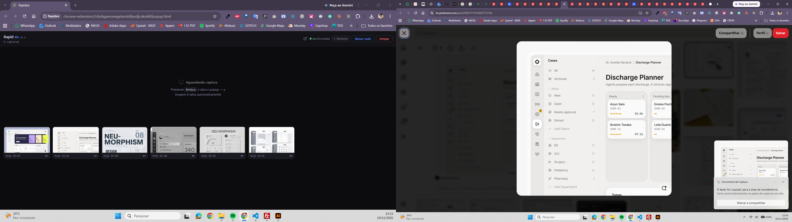
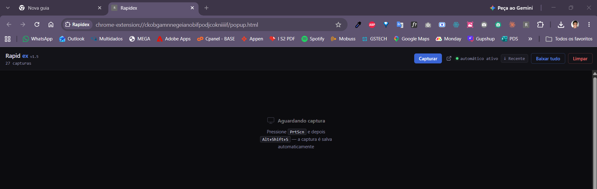

# RapidEX

Extensão Chrome que captura screenshots automaticamente da área de transferência e os organiza em cards. Navegue, colete referências e elas aparecem na outra tela — sem interromper o fluxo.

  -blue)

---

## Como funciona



> Tela esquerda: Rapidex coletando referências em tempo real. Tela direita: navegação normal no Pinterest. Cada `PrtScn` vira um card automaticamente.

---

## Funcionalidades

- **Captura automática** — monitora o clipboard via Native Host (Python); nenhum clique necessário
- **Cards organizados** — grid com miniatura, data/hora e exclusão individual
- **Colunas ajustáveis** — slider de 2 a 6 colunas, salvo entre sessões
- **Lightbox com zoom** — scroll para zoom (até 8×), arrastar para mover, setas ← → para navegar entre capturas
- **Download** — salvar card como JPG ou baixar todas as capturas em ZIP
- **Status em tempo real** — indica se o monitoramento automático está ativo



---

## Instalação

### 1 — Carregar a extensão no Chrome

1. Baixe ou clone este repositório
2. Abra `chrome://extensions`
3. Ative **Modo do desenvolvedor** (canto superior direito)
4. Clique em **Carregar sem compactação** e selecione a pasta `rapidex-extension`
5. Anote o **ID** exibido no card da extensão (ex: `ckobgamn...`)

### 2 — Instalar o Native Host (captura automática)

> Sem este passo a extensão funciona, mas exige clicar no ícone para capturar.

**Pré-requisito:** Python 3.8+ instalado e no PATH

```powershell
cd rapidex-extension
.\setup.ps1
```

O script vai:
- Instalar `Pillow` se necessário (`pip install pillow`)
- Pedir o ID da extensão
- Gerar `com.rapidex.clipboard.json` com os caminhos corretos desta máquina
- Registrar o host nativo no Windows Registry

Após o setup, recarregue a extensão em `chrome://extensions`. O status deve exibir **"automático ativo"** (ponto verde).

---

## Como usar

### Fluxo básico

```
1. Abra o Rapidex como aba em uma segunda tela (clique em ↗ no popup)
2. Navegue normalmente na outra tela
3. Pressione PrtScn ou use o Snipping Tool
4. O card aparece automaticamente no Rapidex
```

### Sem o Native Host

```
1. Pressione PrtScn
2. Clique no ícone do Rapidex na barra do Chrome
3. A imagem é capturada e salva ao abrir o popup
```

### Controles

| Ação | Resultado |
|------|-----------|
| `PrtScn` / Snipping Tool | Imagem vai para o clipboard |
| Aguardar ~0.5s (com Native Host) | Card aparece automaticamente |
| Clicar no ícone da extensão | Captura manual e feedback imediato |
| Slider de colunas no cabeçalho | Redimensiona o grid (2–6 colunas) |
| Clicar em um card | Abre lightbox |
| Scroll no lightbox | Zoom in/out (até 8×) |
| Arrastar no lightbox (com zoom) | Move a imagem |
| `←` / `→` ou botões | Navega entre capturas |
| `Esc` | Fecha lightbox |
| Botão × no card | Exclui a captura |
| **Baixar tudo** | ZIP com todas as capturas em JPEG |

---

## Arquitetura

```
PrtScn
  └─ clipboard do Windows
       └─ rapidex_host.py  (Python, monitoramento a cada 500ms)
            └─ chrome.runtime.connectNative  (Native Messaging)
                 └─ background.js  (Service Worker)
                      └─ chrome.storage.local
                           └─ popup.js  (storage.onChanged → card renderizado)
```

Sem o Native Host, o `popup.js` lê o clipboard diretamente via `navigator.clipboard.read()` quando a popup está em foco.

---

## Estrutura do projeto

```
rapidex-extension/
├── manifest.json        # Configuração MV3 (permissions, commands)
├── background.js        # Service Worker — Native Host + offscreen doc
├── offscreen.html/js    # Documento offscreen (fallback)
├── popup.html           # UI principal
├── popup.js             # Lógica: render, lightbox, zoom, polling
├── rapidex_host.py      # Monitor de clipboard (Python + Pillow)
├── rapidex_host.bat     # Wrapper para o host nativo no Windows
├── setup.ps1            # Instalação do Native Host (Windows)
└── screenshots/         # Prints reais para documentação
```

---

## Requisitos

| Componente | Requisito |
|------------|-----------|
| Chrome | 116+ |
| OS | Windows 10/11 |
| Python | 3.8+ com Pillow (apenas para captura automática) |

---

## Segurança

Ver [SECURITY.md](SECURITY.md) para detalhes sobre as defesas implementadas: CSP, bloqueio de SVG, validação de data URLs, proteção contra XSS por storage tampering, limites de DoS e deduplicação por SHA-1.

---

## Limitação conhecida

O Chrome não permite que extensões leiam o clipboard sem foco do documento — restrição de segurança do browser. O Native Host contorna isso monitorando o clipboard via API do SO (`PIL.ImageGrab.grabclipboard()`). Sem ele, a captura só funciona quando a popup está aberta e em foco.
